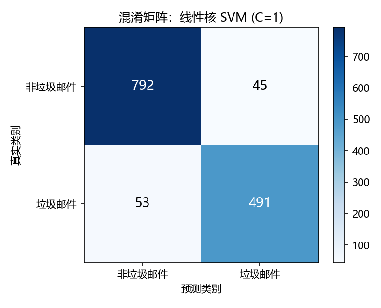
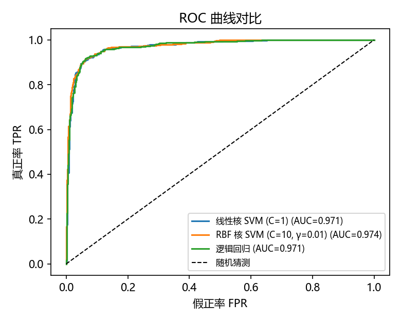

# Week 3 作业：使用 SVM 对 Spambase 垃圾邮件数据集分类

## 一、作业要求

使用课件（SVM 专题）中描述的数据集，尝试做数据分类，并将代码（`.py`）与分析描述写入 markdown，推送到仓库。

## 二、数据集选择

选用课件 **「案例①：垃圾邮件分类」** 描述的 **Spambase** 数据集：

| 项目 | 说明 |
|---|---|
| 来源 | [UCI Machine Learning Repository](https://archive.ics.uci.edu/dataset/94/spambase)（已随仓库保存于 `data/spambase.data`） |
| 规模 | 4601 封邮件，57 个特征 |
| 特征构成 | 48 个词频（word_freq）+ 6 个字符频率（char_freq）+ 3 个大写字母连续长度统计 |
| 标签 | 0 = 非垃圾邮件（2788 封），1 = 垃圾邮件（1813 封，占 39.4%） |
| 特点 | 维度较高（57 维）、样本量中等、线性可分性较好 —— 正是课件指出的「SVM 甜区」 |

## 三、实验流程

完整代码见 [`svm_spambase.py`](./svm_spambase.py)，流程严格对应课件「实践流程建议」：

### 1. 划分与标准化

```python
X_train, X_test, y_train, y_test = train_test_split(
    X, y, test_size=0.30, random_state=42, stratify=y)   # 分层抽样保持类别比例

scaler = StandardScaler()
X_train_s = scaler.fit_transform(X_train)   # 只在训练集上 fit，防止数据泄漏
X_test_s  = scaler.transform(X_test)
```

> 课件强调：**SVM 对特征尺度非常敏感，必须先标准化**。词频特征（0~100%）与大写字母长度（0~几万）尺度差异巨大，不标准化 RBF 核会完全失效。

### 2. 线性核 SVM 作 baseline

```python
svm_linear = SVC(kernel="linear", C=1.0)
```

### 3. RBF 核 + 网格搜索 C 与 gamma

```python
param_grid = {"C": [0.1, 1, 10, 100], "gamma": [0.0001, 0.001, 0.01, 0.1]}
grid = GridSearchCV(SVC(kernel="rbf"), param_grid, cv=5, scoring="accuracy", n_jobs=-1)
```

### 4. 逻辑回归作为对照组

对应课件案例①对比表中的 Logistic Regression。

## 四、实验结果

### 1. 网格搜索结果

- 最优参数：**C = 10，gamma = 0.01**（5 折交叉验证准确率 0.9376）
- 搜索空间 16 组参数组合，总耗时约 3.8 s

### 2. 测试集（1381 封）性能对比

| 模型 | 准确率 | 精确率 | 召回率 | F1 | AUC | 训练耗时(s) |
|:---|---:|---:|---:|---:|---:|---:|
| 线性核 SVM (C=1) | **0.9290** | 0.9160 | **0.9026** | **0.9093** | 0.9706 | 0.16 |
| RBF 核 SVM (C=10, γ=0.01) | 0.9276 | **0.9269** | 0.8860 | 0.9060 | **0.9737** | 3.79 |
| 逻辑回归 | 0.9283 | 0.9222 | 0.8934 | 0.9076 | 0.9712 | **0.02** |

### 3. 支持向量与稀疏性

| 模型 | 支持向量数 | 占训练样本比例 |
|:---|---:|---:|
| 线性核 SVM | 679 / 3220 | 21.1% |
| RBF 核 SVM | 717 / 3220 | 22.3% |

约 78% 的训练样本 αᵢ = 0，对决策边界毫无影响 —— 直观验证了课件所讲的 **KKT 互补松弛性 ⟹ 稀疏性**。

### 4. 图表

<div align="center">

| 混淆矩阵（RBF 最优模型） | ROC 曲线对比 |
|:---:|:---:|
|  |  |

</div>

混淆矩阵解读（RBF 模型，测试集 1381 封）：

- 非垃圾邮件识别得较好：误把正常邮件判为垃圾（假正）的数量较少，对应**精确率 0.927**
- 垃圾邮件有约 11% 漏网（假负），对应**召回率 0.886**

## 五、结果分析

### 1. 为什么三个模型表现几乎一样好（92.8%~92.9%）？

这正是课件案例①的核心结论：**文本类数据维度高（57 维）、样本相对少、线性可分性好**。在这种「n 与 d 同量级、类间空隙明显」的数据上：

- 线性核已经能把绝大多数样本分开，RBF 核的额外非线性表达能力**用不上**；
- 因此 RBF 核（0.9276）并没有超过线性核（0.9290），反而因 gamma 敏感、需要调参而略占下风；
- 逻辑回归与线性 SVM 的决策形式同为线性超平面，性能自然趋同。

印证课件「甜区」判断：**高维、中等样本量场景，线性核是首选**。

### 2. 三个 SVM 视角的观察

- **间隔与 C**：网格搜索选出 C=10 而非 C=100，说明数据存在少量噪声样本，过大的 C 会为了迁就它们把间隔压得过窄（对应课件软间隔推导中「街道宽度 vs 违规惩罚」的权衡）。
- **gamma 的作用**：最优 γ=0.01 较小，边界平滑接近线性 —— 若 γ 过大（如 0.1），每个样本影响范围过小，会围着噪声点画圈导致过拟合（课件「高斯小灯泡半径」的直觉）。
- **稀疏性**：仅约 21% 的样本成为支持向量，预测时只需与这 679/717 个点做核运算，验证了最大间隔解的稀疏性质。

### 3. 模型选择的实际考量

| 考量 | 结论 |
|---|---|
| 性能 | 三者 AUC 均在 0.97 以上，差异可忽略 |
| 训练/推理成本 | 逻辑回归最快（0.02s），线性 SVM 次之（0.16s），RBF 最慢（3.79s） |
| 工程建议 | 该数据集上选**线性核 SVM 或逻辑回归**即可；只有当线性核明显欠拟合时才升级 RBF 核 |

## 六、环境依赖

```
pandas, numpy, scikit-learn, matplotlib
```

复现方式：

```bash
cd week03
python svm_spambase.py
```
